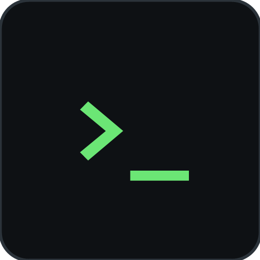

# 证道终端（Zhengdao Terminal）

从 [证道](https://github.com/pisces19860207/zhengdao) 拆出的**独立终端 App**：真 PTY、Debian 13.7 rootfs、PRoot 免 root。证道本体只保留认知型 harness（抱朴）与浏览器（玄览）；要 shell 的时候，用这个。

> **当前状态**：迁移已完成（2026-10-27 第四刀）——终端内核（PTY / rootfs / proot）与终端页都在本仓，
> 主仓那边已删。首个可安装版本以 [Releases](https://github.com/pisces19860207/zhengdao-term/releases) 为准（还没发就是还没有）。

## 它是什么

一个装在手机上的 Linux 终端，不是远程 SSH，也不是网页终端：

- **真 PTY**：终端仿真基于 Termux `TerminalView`，vim / htop / tmux 这类全屏程序正常跑。
- **真 Debian**：首次在 App 内下载 Debian 13.7（trixie）rootfs（约 200 MB，需联网），之后 `apt` 可用。
- **免 root**：PRoot 把 rootfs 映射进来，不需要 root、不需要 Termux、不需要 Shizuku，也不用连电脑。
- **单会话 tmux**：固定一个 tmux 会话；App 被杀重开后会话能接回来（不丢现场）。
- **Agent 安装卡**：Hermes / Claude Code / Codex / AGY CLI 都**不是预装**，点了安装才有；不装就不占地方。

## 与证道的关系

| | 证道（主仓） | 证道终端（本仓） |
|---|---|---|
| 定位 | 认知型 harness：抱朴 ＋ 玄览 | 终端：PTY ＋ rootfs ＋ proot |
| 跑命令 | 不跑 shell、不起子进程 | 就是用来跑命令的 |
| 安装包 | 一个 APK，Agent 不依赖终端 | 独立 APK，可与证道并存 |

两边可以装在同一台手机上，互不依赖；证道不会替终端做决定，终端也不接管抱朴。

## 图标



暗底 `>_`，与主仓白底「证」+ 绿光标区分开；SVG 源文件与 Android 自适应图标资源在 [`assets/icon/`](assets/icon/)。

## 要求

- **Android 16（API 36）或更高版本**
- **arm64-v8a** 设备（只提供 arm64 单架构包）
- 首次装环境需联网（约 200 MB）；之后终端可离线用

## 使用

1. 从 [Releases](https://github.com/pisces19860207/zhengdao-term/releases) 下载 APK 安装。
2. 首次打开，授权存储等权限；在 App 内下载 Debian 环境。
3. 下载完成后进入终端；`apt update`、`apt install` 按需装包。
4. 需要第三方 Agent 时，在安装卡里点安装，装好才有。

环境包支持断点续传与差分更新；网络抖动不用从头下。

## 权限（为什么需要，照实说）

安装包在 `AndroidManifest.xml` 里**声明**了下面这些权限；运行时申请与授权流程随终端内核一起进来（当前骨架期不会弹任何权限框）。

| 权限 | 为什么需要 |
|---|---|
| `INTERNET` / `ACCESS_NETWORK_STATE` | 首次下载 Debian rootfs（约 200 MB）、`apt` 联网、你跑的联网命令；以及判断"现在能不能下" |
| `MANAGE_EXTERNAL_STORAGE`（所有文件访问） | **与 Termux 同款**：proot 里的进程就是 App 的 UID，要读写你选定的共享目录（`Download/证道`）就必须有它。⚠️ 这条**不能由 App 自己申请**，必须你在「系统设置 → 应用 → 证道终端 → 所有文件访问」里**单独授权**；不授权时终端只能在自己的私有目录里工作 |
| `READ_EXTERNAL_STORAGE` / `WRITE_EXTERNAL_STORAGE` | 共享存储的历史通道。Android 16 下这两条已不再授予共享存储访问，保留声明只为与主仓清单形态一致；真正通道是上一条 |
| `FOREGROUND_SERVICE` + `FOREGROUND_SERVICE_SPECIAL_USE` | 长会话保活：离开终端页后会话要继续跑。终端会话不属于任何既有前台服务类型，故用 `specialUse` |
| `POST_NOTIFICATIONS` | 保活通知（Android 13+ 运行时权限；不给就发不出，保活等于没提示） |
| `WAKE_LOCK` | 前台服务里持 `PARTIAL_WAKE_LOCK`，屏幕灭了会话不被 CPU 休眠掐断 |
| `REQUEST_IGNORE_BATTERY_OPTIMIZATIONS` | 一键跳「电池优化白名单」，只在**你确认后**跳转，不静默申请 |

**终端不是沙箱**（见下节），给了全盘权限之后更是如此：只运行你信任的命令。

## 安全（照实说）

⚠️ **终端不是安全沙箱**：里面的进程与 App 是同一个 Android UID、同一个内核与网络栈，能读写 App 能读写的文件。只运行你信任的命令；不要拿它跑来源不明的脚本。

## 许可与第三方

- 本仓第一方代码为项目原创；自 2026-10-11 起「保留所有权利」，只允许浏览/克隆源码与安装官方包，不允许自行构建、修改、反向工程或再分发（法律强制允许的除外）；商业使用需事先取得书面许可。
- 随包第三方组件各按其许可证分发：
  - Termux `terminal-emulator` / `terminal-view`（Apache-2.0）
  - PRoot（GPL-2.0，聚合分发）
  - Debian rootfs 及其中的软件包（各自许可证）
  - JetBrains Maple Mono 字体（OFL-1.1）
- 许可证正文在仓内 `licenses/`（Apache-2.0 / GPL-2.0 / GPL-3.0 / LGPL-3.0 / BSD 系 ＋ `NOTICES.txt`）；
  **完整清单看本仓**的 [`THIRD-PARTY-LICENSES.md`](THIRD-PARTY-LICENSES.md) 与 [`PROVENANCE.md`](PROVENANCE.md)。
  ⚠️ 正文目前**只入库、还没装配进 APK**，App 内也还没有「开源许可」阅读页 —— 这一条以
  `PROVENANCE.md` §8「已知缺口」为准，别把上面的清单当成合规闭环已完成。
- 本仓自己的同名文件：`LICENSE`（第一方条款）、`PROVENANCE.md`（来源与出处）、`THIRD-PARTY-LICENSES.md`（第三方清单与义务）；
  主仓（证道）的那三份**只覆盖主仓**（抱朴 ＋ 玄览），不覆盖本仓。

## 构建

官方包的构建口径（写在这里是为了可复现与可审计；**许可仍以 `LICENSE` 为准**——它不授权自行构建后再分发）：

- JDK 21、Gradle 9.6（wrapper 自带，无需另装）、AGP 9.4.0、Kotlin 2.2.10
- `compileSdk` / `minSdk` / `targetSdk` = 36；ABI 只打 `arm64-v8a`
- `applicationId` = `com.example.zhengdao.term`（与证道主仓 `com.example.zhengdao` 不同，可并存安装）

```bash
./gradlew :app:assembleDebug      # 产物：app/build/outputs/apk/debug/app-debug.apk
```

本仓是**两个模块**：`:app`（壳与终端页）＋ `:terminal-core`（PTY / rootfs / proot，2026-10-27 第四刀整模块迁入）。
共享层（主仓的 `:core` / `:native-core`）**不建成本仓模块**，以随仓 `libs/*.aar` 复用，
所以克隆本仓直接能编 —— 不需要 `mavenLocal()`，也不要求主仓先发布一次。

## 致谢

终端层建立在 Termux、PRoot、Debian 与这些开源项目之上；没有它们就没有「手机上免 root 跑 Linux」这件事。

---

**English (short)**: Zhengdao Terminal is a standalone Android terminal app split out of [Zhengdao](https://github.com/pisces19860207/zhengdao): a real PTY, a Debian 13.7 rootfs and PRoot, no root, no Termux, no Shizuku. Zhengdao itself keeps only the agent harness (Baopu) and the browser (Xuanlan). Requires Android 16+ on arm64. The terminal is **not a security sandbox** — run only commands you trust. Migration is complete (fourth cut, 2026-10-27): the terminal core and the terminal screen both live in this repo, as two modules (`:app` + `:terminal-core`). Installable builds will appear under Releases.
